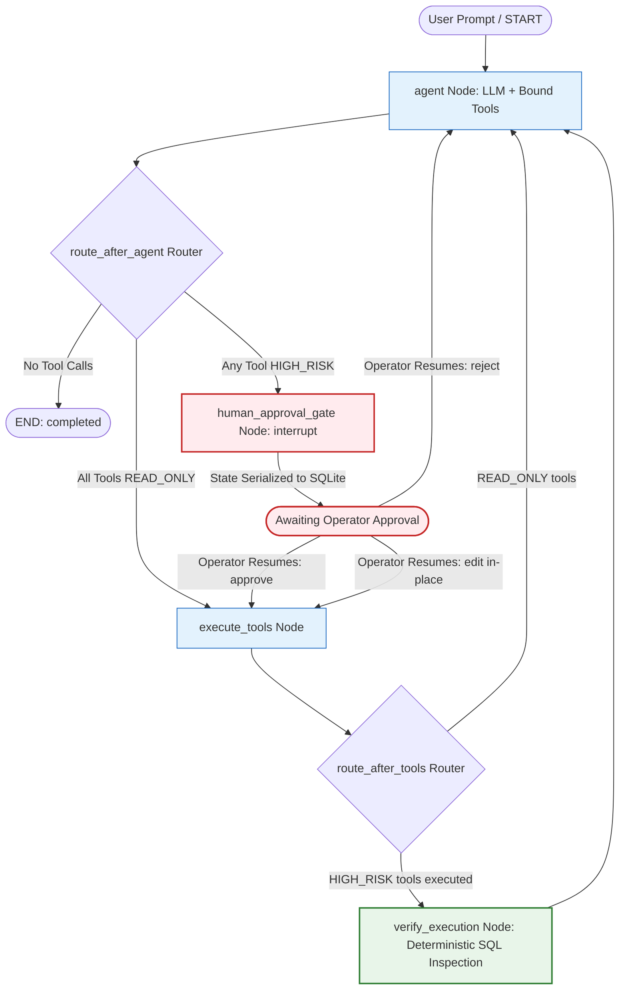

# Stateful LangGraph Customer & Refund Operations Agent with HITL Governance

[](#test-suite-offline-verification)
[](#automated-hitl-governance--reliability-benchmark)
[](#dual-llm-compatibility-100-0-stack)
[](#api-reference)
[](#streamlit-operator-console)
[](https://github.com/mariahunzai1)

App Live Demo: https://stateful-langgraph-hitl-agent-kigo9j8ipzmfbpcasbugzr.streamlit.app/

> **Portfolio Showcase (Project 2)** by **Maria Ali** ([`mariahunzai1`](https://github.com/mariahunzai1))  
> A production-grade, stateful customer and refund operations agent built with **LangGraph**, **SQLite checkpoint persistence (`SqliteSaver`)**, **Human-in-the-Loop (`interrupt()`) authorization gates**, and **deterministic post-tool SQL verification** on a **100% $0 stack**.

---

## Executive Summary: Why Production Agents Require HITL Governance

Autonomous LLM tool calling is fundamentally non-deterministic. In financial, operational, or enterprise workflows:
1. **Unchecked Tool Calling Causes Real-World Loss**: An unconstrained LLM can issue unauthorized refunds, violate return policies, double-refund claims, or perform destructive database mutations based on hallucinations or prompt injection.
2. **Prompt Instructions Are Not Safety Guarantees**: Prompting an LLM to *"always ask for confirmation before issuing refunds"* regularly fails under edge cases, model updates, or adversarial inputs.
3. **In-Memory Agents Lose State on Crash**: If an agent server restarts mid-turn, pending operations and conversation histories vanish unless backed by durable disk checkpoints.
4. **Self-Reported Execution Is Unreliable**: An agent reporting *"I have issued your refund"* does not mean the database transaction succeeded.

### The Architectural Solution:
This project enforces a **defense-in-depth architectural boundary**:
- **Deterministic Risk Tiering**: Every tool is tagged programmatically (`ToolRiskLevel.READ_ONLY` vs. `ToolRiskLevel.HIGH_RISK`). The LangGraph conditional router inspects tool metadata directly—never relying on LLM self-reporting.
- **Native LangGraph `interrupt()` Gates**: High-risk mutating actions halt execution and serialize the pending state to SQLite via `SqliteSaver`. The human operator can **Approve**, **Edit in-flight arguments** (e.g., adjust refund amounts), or **Reject**.
- **Crash Durability**: Thread state, interrupt payloads, and message histories survive complete server crashes and reboots.
- **Deterministic Post-Tool Verification**: Immediately following high-risk mutations, non-LLM SQL queries inspect row-level table states (`refund_ledger`, `orders`, `customers`, and append-only `audit_logs`) to verify data integrity before returning a synthesized answer.

---

## LangGraph State Machine Architecture



---

## Automated HITL Governance & Reliability Benchmark

A deterministic 11-scenario evaluation harness (`eval.benchmark`) rigorously tests the agent across autonomous query execution, high-risk interception, pre-mutation protection, in-flight argument modification, and crash recovery.

```
========================================================================================
 STATEFUL LANGGRAPH HITL GOVERNANCE & RELIABILITY BENCHMARK REPORT
 Portfolio Showcase: mariahunzai1 | Project 2 | 100% $0 Stack
========================================================================================

Total Evaluation Scenarios: 11 | Passed: 11 | Failed: 0

| Metric                                      | Target  | Achieved | Status |
|:--------------------------------------------|:-------:|:--------:|:------:|
| Read-Only Autonomy Rate                     | 100.0%  |  100.0%  | PASS ✅  |
| High-Risk Interception Precision            | 100.0%  |  100.0%  | PASS ✅  |
| Unauthorized Mutation Prevention Rate       | 100.0%  |  100.0%  | PASS ✅  |
| Post-Execution DB Verification Accuracy     | 100.0%  |  100.0%  | PASS ✅  |
| Crash-Recovery State Durability             | 100.0%  |  100.0%  | PASS ✅  |
----------------------------------------------------------------------------------------

Scenario Breakdown:
  1. [PASS ✅] Read-Only Customer Profile Lookup                  (Read-Only Autonomy) in 147.6ms
  2. [PASS ✅] Read-Only Order Details Retrieval                  (Read-Only Autonomy) in 134.9ms
  3. [PASS ✅] Deterministic 30-Day Window Eligibility Check      (Read-Only Autonomy) in 104.3ms
  4. [PASS ✅] Expired Order Policy Ineligibility Detection       (Read-Only Autonomy) in 441.0ms
  5. [PASS ✅] Chained Multi-Tool Customer Inquiry Flow           (Read-Only Autonomy) in 137.1ms
  6. [PASS ✅] High-Risk Refund Gate Interception & Pre-Mutation Hold (Interception Precision) in 98.2ms
  7. [PASS ✅] Subscription Tier Upgrade Gate Interception        (Interception Precision) in 119.8ms
  8. [PASS ✅] Human Authorization & Deterministic SQL Verification (Verification Accuracy) in 302.3ms
  9. [PASS ✅] In-Flight Parameter Patching & Ledger Verification (In-Flight Argument Modification) in 318.2ms
 10. [PASS ✅] Human Rejection & Zero Unauthorized Mutation Guard (Mutation Prevention) in 117.3ms
 11. [PASS ✅] SQLite Checkpoint Persistence & Crash-Recovery Durability (Durability) in 283.3ms
========================================================================================
```

To run the benchmark independently:
```powershell
python -m eval.benchmark
```

---

## Dual LLM Compatibility (100% $0 Stack)

The system interfaces exclusively through `langchain-openai.ChatOpenAI`, allowing instant switching between a fully offline local environment and cloud deployments:

| Deployment Mode | Provider | Model | Base URL | Cost |
|:---|:---|:---|:---|:---:|
| **Local Offline** | Ollama | `llama3.2:3b` | `http://localhost:11434/v1` | **$0.00** |
| **Cloud Deployment** | Google AI Studio | `gemini-3.5-flash-lite` | `https://generativelanguage.googleapis.com/v1beta/openai/` | **$0.00** (Free Tier) |

---

## API Reference

The FastAPI backend exposes typed Pydantic v2 endpoints:

| Method | Endpoint | Request Body | Description |
|:---|:---|:---|:---|
| `GET` | `/health` | _None_ | Returns backend health, active model, and LLM base URL. |
| `POST` | `/agent/run` | `AgentRunRequest` | Submits a user prompt, executing until completion or pausing at a HITL gate. |
| `POST` | `/agent/resume` | `AgentResumeRequest` | Resumes a paused thread with an operator decision (`approve`, `edit`, or `reject`). |
| `GET` | `/threads/{thread_id}` | _None_ | Reconstructs thread state and active interrupts directly from SQLite checkpoints. |
| `GET` | `/ops/snapshot` | _None_ | Returns real-time database rows (`customers`, `orders`, `refund_ledger`, `audit_logs`). |
| `POST` | `/ops/reset` | _None_ | Resets and re-seeds operational demo data for clean demonstration runs. |

---

## Quickstart Guide

### Option A: Local Ollama ($0 Local Stack)
1. Ensure Ollama is installed and run:
   ```bash
   ollama pull llama3.2:3b
   ```
2. Create and activate a virtual environment:
   ```powershell
   python -m venv .venv
   .venv\Scripts\Activate.ps1
   pip install -r requirements.txt
   ```
3. Copy environment configuration:
   ```powershell
   cp .env.example .env
   ```
4. Start the FastAPI backend:
   ```powershell
   uvicorn api.main:app --port 8000 --reload
   ```
5. In a second terminal, launch the Streamlit console:
   ```powershell
   streamlit run ui/streamlit_app.py
   ```

---

### Option B: Single-Command Mode (Streamlit Community Cloud / Embedded FastAPI)
The Streamlit app includes an automated background self-launcher (`NoSignalServer`). In environments where only a single command can be executed (such as Streamlit Community Cloud):
```powershell
streamlit run ui/streamlit_app.py
```
If port 8000 is not running, Streamlit automatically boots the FastAPI backend in a background daemon thread and connects to it over HTTP.

---

### Option C: Docker Compose
Run the complete multi-container stack with persistent volumes:
```bash
docker compose up --build
```
- FastAPI API: `http://localhost:8000/docs`
- Streamlit Console: `http://localhost:8501`

---

## Test Suite & Offline Verification

The project includes 37 automated tests verifying database logic, policy windows, tool risk metadata, LangGraph execution, crash durability, API endpoints, and architectural import boundaries (100% offline, 0 LLM API credits consumed):

```powershell
pytest -v
```

### Test Coverage Highlights:
- **`tests/test_database.py` (11 tests)**: Foreign keys, WAL mode, idempotent demo seeding, double-refund prevention, over-refund rejection, subscription tier updates, and audit log immutability.
- **`tests/test_tools.py` (12 tests)**: Pydantic v2 input/output validation, deterministic 30-day refund policy window evaluation, tool risk metadata tagging (`READ_ONLY` vs `HIGH_RISK`).
- **`tests/test_graph.py` (5 tests)**: Autonomous read-only queries, high-risk pause/interrupt, operator approval, in-flight parameter editing, rejection protection, and **crash/restart state durability**.
- **`tests/test_api.py` (8 tests)**: **AST boundary inspection** confirming `ui/streamlit_app.py` never imports `core` or `sqlite3`, health, snapshot, reset, run, thread recovery, and resume endpoints.
- **`tests/test_eval.py` (1 test)**: Verification that the 11-scenario governance benchmark achieves 100.0% across all reliability metrics.

---

## Project Structure

```text
stateful-langgraph-hitl-agent/
├── .agents/
│   └── rules/
│       └── langgraph-engineering-standards.md  # Architectural rules & separation of concerns
├── api/
│   ├── __init__.py
│   └── main.py                                 # FastAPI REST backend & dependency injectors
├── core/
│   ├── __init__.py
│   ├── config.py                               # Settings singleton via pydantic-settings
│   ├── database.py                             # SQLite operational DB, WAL mode & seed data
│   ├── graph.py                                # LangGraph topology, interrupt gate & AgentService
│   ├── llm.py                                  # Dual LLM factory (ChatOpenAI wrapper)
│   ├── schemas.py                              # Pydantic v2 contracts for state, tools & API
│   └── tools.py                                # Risk-tiered tools (READ_ONLY vs HIGH_RISK)
├── eval/
│   ├── __init__.py
│   └── benchmark.py                            # 11-scenario automated governance evaluation suite
├── tests/
│   ├── conftest.py                             # Pytest fixtures & isolated DB tempfiles
│   ├── test_api.py                             # API integration & AST import isolation tests
│   ├── test_database.py                        # Database mutations, constraints & audit logs
│   ├── test_eval.py                            # Benchmark suite offline verification
│   ├── test_graph.py                           # LangGraph state machine & crash durability
│   └── test_tools.py                           # Risk metadata & policy boundary tests
├── ui/
│   ├── __init__.py
│   └── streamlit_app.py                        # Decoupled Streamlit HITL Operator Console
├── .env.example                                # Template for local Ollama / Google AI Studio
├── .gitignore                                  # Git ignore rules for virtualenvs, locks, sqlite
├── docker-compose.yml                          # Multi-container orchestration (api + ui)
├── Dockerfile                                  # Python 3.11-slim production container
├── pytest.ini                                  # Pytest configuration
└── requirements.txt                            # Pinned production dependencies
```

---

## Author & Portfolio Contact

**Maria Ali**  
AI / Machine Learning Engineer  
- GitHub: [@mariahunzai1](https://github.com/mariahunzai1)  
- Portfolio Project: `mariahunzai1/stateful-langgraph-hitl-agent`
